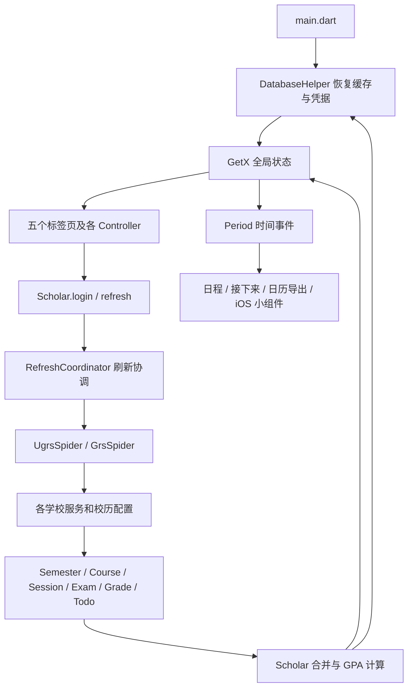

> 历史资料：本文描述重构前仓库。当前目录与接口请看 [框架接口与续开发](框架接口与续开发.md)。

# Celechron 项目开发介绍与魔改导航

> 梳理日期：2026-10-15。对象：当前 `Celechron-main` 目录中的源码快照。
> 本文依据本地代码静态阅读，不代表学校线上接口当前可用性，也不是完整代码审计。未修改业务代码。当前 shell 未发现 Flutter/Dart，未执行编译、测试或真实账号登录。

## 1. 项目是什么

Celechron 是面向浙江大学学生的时间管理应用。当前代码除了课表，还实现了成绩/GPA、考试、学在浙大作业、二三四课堂记点、个人任务与固定日程、DDL 自动排程、校园卡付款码、日历导出、移动端后台通知、iOS 小组件和 Apple Watch。

它是 Flutter 客户端项目；仓库中没有配套后端源代码。客户端直接访问学校多个业务系统，同时依赖 Celechron 自有的校历配置和版本检查服务。README 仅提供简短介绍，实际功能应以代码为准，不能据此认定这是学校官方维护的应用。

本次文件清单共有 **337 个原有文件**，其中 `lib/` 有 **109 个 Dart 文件，约 29,196 行**；`test/` 有 **14 个测试文件及 1 个日志 fixture**。统计不含本文和附录。

### 技术栈与本地配置

| 项目 | 当前源码事实 | 对开发的影响 |
| --- | --- | --- |
| 框架 | Flutter / Dart，包名 `celechron` | 主要业务修改集中在 `lib/` |
| 界面 | `GetCupertinoApp`、Cupertino 组件，局部 Material 图标 | 默认是 iOS 风格，并非 Android Material 风格 |
| 状态管理 | GetX 的 `Get.put/find`、带 tag 的全局依赖、Rx/Obx/ever | 修改普通嵌套对象后常需显式 `.refresh()` |
| 普通持久化 | Hive，自写 TypeAdapter | 修改字段要同步存储适配和兼容恢复 |
| 凭据存储 | `flutter_secure_storage` | 用户名、密码、校园卡凭据有独立存储链路 |
| 网络 | `dart:io` 的 HttpClient，手工处理 Cookie/重定向 | 不是 Dio/Retrofit 架构 |
| 当前应用版本 | `pubspec.yaml` 为 `1.3.1+1` | `worker/fuse.dart` 另有手写版本，也要关注 iOS 配置 |
| Dart 约束 | `sdk: ">=3.0.0"` | 仅下界，不足以判断最低可运行 Flutter 版本 |
| Android 构建 CI | Flutter `3.38.1`、JDK `17`、Gradle `8.13` | 是源码提供的可参考环境，尚未在本机验证 |
| Android | AGP `8.13.2`、Kotlin `2.2.0`、minSdk `28` | Gradle 配置中的 Java/Kotlin 编译目标为 11，与构建 JDK 区分 |
| Apple 平台 | iOS 主工程部署目标 15.0；watchOS 10.0 | 真机、签名和扩展须在 macOS/Xcode 处理；具体能力还有系统版本分支 |
| 许可证 | 仓库 `LICENSE` 为 GNU GPL v3 文本 | 对外发布前阅读原许可证 |

`pubspec.yaml` 还包含：`table_calendar`、`workmanager`、`flutter_local_notifications`、`qr_flutter`、`device_calendar`、`timezone`、`share_plus`、`app_links`、`pigeon` 等。`workmanager` 来自 Celechron 的 Git 仓库 `main` 分支，许多其他依赖未固定版本，当前快照也没有 `pubspec.lock`，因此依赖解析结果可能随时间变化。

## 2. 代码目录

```text
Celechron-main/
├── lib/
│   ├── main.dart                 启动、全局依赖、生命周期、通知和深链
│   ├── page/                     按功能划分的界面与 GetX Controller
│   │   ├── home_page.dart         五个底部标签页
│   │   ├── flow/                 “接下来”与自动排程
│   │   ├── calendar/             月历/日程和日程式课表
│   │   ├── task/                 任务列表、编辑、状态和持久化
│   │   ├── scholar/              学业首页、课程、课表、考试、成绩、实践记点
│   │   ├── search/               已获取课程的本地搜索
│   │   └── option/               设置、登录、付款码、诊断、关于等
│   ├── model/                    学业模型、时间模型、日历导出和系统同步
│   ├── http/
│   │   ├── spider.dart           抓取器接口及刷新结果协议
│   │   ├── ugrs_spider.dart      本科数据抓取编排，附 MockSpider
│   │   ├── grs_spider.dart       研究生数据抓取编排
│   │   └── zjuServices/          CAS、教务、研究生院、课程、素拓、校园卡
│   ├── services/                 刷新互斥、日志脱敏、诊断报告
│   ├── database/                 Hive 与安全存储封装及适配器
│   ├── algorithm/                自动排程算法
│   ├── worker/                   后台学业刷新、小组件桥接、版本检查
│   ├── pigeon/                   Dart/Swift 通信定义和生成代码
│   ├── design/                   通用卡片、动画、颜色、刷新指示组件
│   ├── utils/                    GPA、时间、JSON、平台判断等
│   └── debug/                    独立的学在浙大认证探针入口
├── test/                         Flutter 单元与组件测试
├── android/                      Android 宿主、Glance 校园卡组件
├── ios/
│   ├── Runner/                   Flutter iOS 宿主与 Watch 桥接
│   ├── Shared/                   Apple 多 target 共用逻辑
│   ├── WidgetExtensions/         iPhone 小组件与 Live Activity 源文件
│   ├── CelechronWatch/           SwiftUI 手表 App、付款码、凭据存储
│   ├── WatchWidgetExtensions/    手表表盘组件
│   └── CelechronWatchTests/      独立 Swift 回归测试及二维码 fixture
├── macos/                        macOS 宿主与签名/工程配置
├── windows/                      Windows C++ 宿主
├── linux/                        Linux GTK 宿主
├── assets/                       App 标志资源
├── .github/workflows/            分析检查、Android APK 构建
├── pubspec.yaml                 Flutter 依赖、版本和资源声明
└── docs/                         本次新增的开发文档
```

**逐文件用途及关键实现见 [文件功能索引](文件功能索引.md)**。附录逐项列出全部原有文件，图片、工程元数据和生成文件也包含在内；主文集中解释业务关系。

## 3. 总体架构和状态流



这是“页面 + Controller + 模型 + 服务”的混合组织，并非严格分层架构。部分模型直接访问 GetX Controller，部分模型也包含 UI 对话框与插件调用，例如 `Scholar._applyFetchResult()` 通过 `Get.find<OptionController>` 获取课程映射，`calendar_to_ical.dart` 同时负责生成与分享 UI。新增独立入口或测试时，要留意这些隐式依赖。

### 启动流程

1. `main()` 初始化 Flutter，安装校园卡 MethodChannel 回调，声明前台活跃。
2. 初始化 Hive 与 `DatabaseHelper`，注册适配器，打开各 Box，并迁移旧版 iOS 安全存储条目。
3. 把缓存恢复为 GetX 对象：`db`、`scholar`、`taskList`、`taskListLastUpdate`、`flowList`、`flowListLastUpdate`、`option`、`fuse`。
4. `runApp(CelechronApp())`，先展示缓存界面。
5. 若缓存 Scholar 带已登录状态，异步调用 `_refreshRestoredScholar()` 重建网络会话并刷新。之后更新校园卡凭据；未登录时也尝试校园卡更新。
6. `CelechronApp` 初始化通知和 App Links；监听生命周期，以心跳维护前台租约，进入后台时更新校园卡。
7. `HomePage` 用 PageView + CupertinoTabBar 管理“接下来 / 日程 / 任务 / 学业 / 设置”，页面保活；延迟检查版本更新。

缓存里的 `isLogan`（源码如此拼写）不代表已有有效 Cookie。Spider 不会随缓存保存，启动后必须重新认证。

### 常见全局依赖

| tag | 对象 | 主要消费者 |
| --- | --- | --- |
| `db` | `DatabaseHelper` | 各 Controller、抓取器、版本检查 |
| `scholar` | `Rx<Scholar>` | 学业、课程、日程、接下来、设置 |
| `taskList` | `RxList<Task>` | 任务、日程、自动排程 |
| `flowList` | `RxList<Period>` | 接下来与进度累计 |
| `option` | `Option`，字段多为 Rx | 设置和界面配置 |
| `fuse` | `Rx<Fuse>` | 版本展示、更新提示 |

页面还自行注册带 tag 的 Controller。若改导航结构、懒加载或初始化顺序，应一并检查 `Get.put` 和 `Get.find`，避免重复注册或依赖未注册。

## 4. 学业登录、抓取和刷新

### 4.1 登录选择与认证链

`model/scholar.dart` 是学业数据的中心：

- `username == '3200000000'`：使用 `MockSpider` 演示数据。
- 其余学号以 `3` 开头：使用 `UgrsSpider`。
- 其余账号：使用 `GrsSpider`。这是代码中的简化判断，不是通用学生类型系统。

`ZjuAm` 负责统一身份认证：请求登录页面、公钥、密码加密提交、获取 SSO Cookie 和指定业务站的 CAS 回调。相同 HttpClient 的并发登录共享 Future，并短期复用内存会话；不同 HttpClient（尤其学业与校园卡）隔离。旧持久化 SSO Cookie 有主动删除逻辑，不能简单理解成“启动就复用磁盘 Cookie”。

抓取器在一次登录中对各子站建立会话，再替换候选 HttpClient。本科主要依赖教务网和学在浙大，素拓与研究生院登录允许失败；研究生主要依赖研究生院和学在浙大，本科教务服务允许失败。登录错误和各模块抓取错误分开记录。部分会话问题会触发有限重登录/重试。

### 4.2 各数据源的责任

| 文件 | 数据源/用途 | 实现要点 |
| --- | --- | --- |
| `http/zjuServices/zjuam.dart` | `zjuam.zju.edu.cn` 统一认证 | HttpClient 级会话、CAS ticket、清除旧凭据缓存 |
| `http/zjuServices/zdbk.dart` | 本科教务 | 成绩、课表、考试、主修成绩、旧实践汇总；验证码、缓存、认证检查 |
| `http/zjuServices/grs_new.dart` | `yjsy.zju.edu.cn` 研究生院 | CAS ticket 兑换、token、课程详情、课表、成绩和考试 |
| `http/zjuServices/courses.dart` | 学在浙大 | 作业 Todo、登录中间跳转、响应检查与缓存 |
| `http/zjuServices/sztz.dart` | `sztz.zju.edu.cn/dekt/` 素拓 | 独立 Cookie 路径/域管理、ctx 校验、记点明细和正式汇总 |
| `http/zjuServices/ecard.dart` | `elife.zju.edu.cn` 校园卡 | Synjones 凭据、校园卡账户和付款码 |
| `http/time_config_service.dart` | Celechron 校历配置 | 网络 → 本地缓存 → 同类学期模板/安全默认配置回退 |
| `worker/fuse.dart` | `api.celechron.top/checkUpdate` | 按平台检查版本，一天内节流 |
| `http/github_service.dart` | GitHub 贡献者 | 关于/致谢页名单，非学业核心数据 |

上述域名来自源码，未联网验证。校历基础地址在 `calendar_config_parser.dart` 中为 `http://calendar.celechron.top/`，服务源代码不在本仓库。更换校历源要同时保留配置结构和回退行为。

### 4.3 一次刷新如何完成

主要调用链：

```text
ScholarController.fetchData() / 启动自动刷新 / 后台入口
  → Scholar.refresh()
  → DiagnosticLogService.runRefresh()
  → RefreshCoordinator.run(account, operation='refresh', origin)
  → 必要时 _loginInternal() 重建 Spider
  → Spider.getEverything()
  → 各数据源分模块执行，聚合 EverythingTuple
  → Scholar._applyFetchResult() / setScholar()
  → 成绩分组、GPA 计算、更新时间、DatabaseHelper.setScholar()
  → scholar.refresh() / 回调通知界面
```

`EverythingTuple` 七项依次是：**登录错误、抓取错误、学期列表、成绩列表、主修成绩、特殊日期、作业列表**。不要把 `item1` 和 `item2` 混为一谈。

本科刷新标签为：校历、课表、考试、成绩、主修、作业、实践。研究生刷新标签为：校历、课表、本科生课考试、本科生课成绩、研究生课考试、研究生课成绩、作业。标签序列与错误数组的下标一一对应。

`attachEverythingProgress()` 允许分块上报，但学期对象由校历、课表等多个任务拼装，未就绪时不能把不完整对象直接暴露为完整课表。

设置里的 `asyncRefresh` 默认关闭，打开后会逐块合并数据；刷新状态文案与开关独立，即使不开异步合并，也可以显示真实模块进度。

### 4.4 缓存、错误与并发约定

- 网络失败不应把旧成绩、旧课表全部清空。`setScholar()` 对不同模块分别保留或合并旧数据；作业成功返回空列表则可清空。
- 异常不仅有“成功/失败”，还区分缓存和降级来源；`data_source_status.dart`、`exceptions.dart`、诊断报告共同描述这些语义。
- 错误列表中的 `null` 为成功，以“查询进行中”结尾为 pending，其余通常为失败。
- `Scholar` 的部分合并和时间戳守卫使用“成绩”“课表”“作业”等中文关键词，随意改错误文案可能改变业务行为。
- 同账号同操作共享正在执行的 Future；同账号不同操作排队；跨 isolate 使用账号哈希对应的文件锁。
- 前台租约默认 30 秒、前台每 10 秒心跳；锁默认 5 秒心跳，超过 30 秒可回收遗留锁。
- 后台检测到活跃前台或忙锁时正常让行；前台可能等待后台锁释放。这与网络失败不同。

修改登录、刷新或错误处理时，优先阅读 `refresh_coordinator_test.dart` 和认证相关测试。

## 5. 课表模型：从“周规则”到“真实日程”

| 模型 | 表示什么 | 典型字段/用途 |
| --- | --- | --- |
| `Scholar` | 一个用户的学业聚合 | semesters、grades、gpa、todos、实践汇总 |
| `Semester` | 学期级聚合 | 课程、教学规则、成绩、考试、节次时间表、日期映射 |
| `Course` | 一门课程的汇总信息 | id/name/credit/teacher，关联 Session、Grade、Exam |
| `Session` | 一条上课规则 | 星期、节次、上/下半学期、单双周、地点、确认状态、研究生周次等 |
| `ExamDto` | 接口侧考试数据 | 供学期转换，含不同接口来源的字段 |
| `Exam` | 已标准化考试 | 课程标识、类型、具体开始结束时间 |
| `Grade` | 一次成绩记录 | 原始分、各绩点制、学分、是否计入 |
| `Period` | 具体日期上的一个时间段 | startTime/endTime/type/uid/fromUid/location |
| `Todo` | 学在浙大作业 | 名称、课程、截止时间、原始作业标识 |
| `Task` | 用户管理的任务/固定日程 | 工作量、进度、截止时间、重复规则、是否阻挡安排 |

`Todo` 和 `Task` 不是同一数据模型；改学校作业列表并不会自动改掉用户 DDL 的状态机。

### 课表形成过程

1. 抓取器读取校历配置，为学期建立节次到钟点、星期到真实日期、单双周/上下半学期的映射。
2. 教务或研究生接口给出 Session；通过 `Semester.addSession()` 等方法归入课程和学期。
3. 周课表通过 `firstHalfTimetable` / `secondHalfTimetable` 按星期展示确认且可显示的 Session。
4. 日程页、接下来、日历导出等使用 `Semester.periods`：`_buildPeriods()` 将规则展开为具体日期的课程，并加入考试等事件。
5. `Scholar.periods` 汇总所有学期事件；日程 Controller 按日期分组，并在查询当天时补入用户固定日程。

`Semester.periods` 有缓存。修改课程时间、校历、考试、周次或合并逻辑时，必须检查 `_invalidatePeriodsCache()` 是否覆盖变更路径；不要原地排序或修改它直接返回的列表。

校历解析器还包含学年边界、下一学年探测、毕业上限、未来学期判定、缺校历默认值等逻辑。学年边界与“课表何时开放查询”是两回事，不能只用当前月份决定抓取范围。

### 两种主要课表界面

- `page/scholar/course_schedule/`：学业中的传统周课表，主要按半学期和星期排课程卡片。
- `page/calendar/`：日历和日程视图；`schedule_view.dart` 负责日程式布局，依赖真实日期事件。

改课表视觉，先找 View/Card；改周次与落地日期，先找 Session、Semester 和校历解析器；改接口字段，找 zdbk/grs_new，随后检查模型转换。

## 6. 成绩、GPA 与实践记点

### 成绩与重修

`Scholar._applyFetchResult()` 把成绩按课程号归组，兼容课程号格式和课程号手动映射。部分体育类编号有特殊处理。`grades` 是 `Map<String, List<Grade>>`，不是一门课只对应一条成绩。

- 保研口径的代码取分组中的首次记录计算。
- 出国口径取最高百分制分记录。
- `GpaHelper` 负责各分制按学分加权，`Grade` 负责成绩本身的归一化。
- 自定义选课计算在 `grade_detail_controller.dart`；手动权重在 `weighted_gpa_controller.dart`。
- 改课程等价/重修归组：同时查看 `course_id_mapping_edit_page.dart`、`OptionController` 和 Scholar。

需注意代码对列表有原地排序，若要调整“首次”和“最高”的语义，应同时核查抓取排序、持久化恢复与多次刷新后的顺序，不能只改界面文字。

### 二三四课堂

`PracticeScoreItem` 归一化素拓项目、类别、审核状态、实际记点等；`PracticeScoreSnapshot` 和 `PracticeScoreSummary` 表达来源、可用性与陈旧状态。

当前逻辑严格区分：

- **明细**：来自 `getSqjl`，失败时保留上次明细并标记陈旧。
- **正式汇总**：优先网络 `getMyInfo`，其次其有效缓存，再回退为本次可用 `getSqjl` 的审核通过项目合计。
- **旧缓存**：保留兼容语义，不能伪装成本次网络成功。
- 总记点只由第二、第三、第四课堂的 Jf 字段相加；美育/劳育通过状态独立显示。

新增分类或调整记点规则，要同时改服务解析、模型、缓存兼容和页面，现有相关测试可以作为行为说明。

## 7. 任务与自动排程

`Task` 有两种主要用途：`deadline` 是只有截止时间和工作量的 DDL，`fixed` 是固定起止时间的日程；`fixedlegacy` 保存过去日程。还包含暂停、完成、失败、过期等状态，以及不重复/按天/月/年重复规则。

`TaskController` 负责任务状态刷新、保存、排序、批量暂停/继续和清理。编辑页返回 Task，列表据其状态处理保存或删除。很多类和存储仍沿用 `deadline` 命名，阅读时应对应到现有的 `Task`。

### 自动生成安排

入口 `FlowController.generateNewFlowList(startsAt)`：

1. 收集运行中的 DDL，得到最远截止时间。
2. 从每日允许工作时段开始，把学校课程、考试和设置了阻挡安排的固定日程扣除。
3. 将时间边界排序、离散化，形成可用 `Period`。
4. 调用 `algorithm/arrange.dart` 的 `getTimeAssignSet()`。
5. `findSolution()` 按最早截止时间优先贪心分配；可拆分任务受单次工作时长限制，并插入休息。
6. 如果目标休息时长不可行，通过二分尝试更短的分钟级休息；仍不可行则返回无效结果。
7. 成功后把分配得到的 flow 时间段合回时间线，并同步更新版本时间和小组件。

这是贪心排程，不是通用全局最优化求解器。更改优先级、插空策略、不可拆分任务或休息策略时，算法和 `generateNewFlowList()` 的空闲区间生成都需要检查。

### 时间推进和进度累计

`FlowController` 每秒更新时钟；完整 `walkFlowList()` 主要在数据改变或时间边界执行，最长约一分钟自愈。它删除过期片段、同步任务描述、补入临近课程和重复日程，并把 flow 经过的时间累加到任务进度。

进行中每约 15 秒保存一次累计快照。**任务的 `timeSpent` 与 flow 的 `lastUpdateTime` 要成对保存**，否则杀进程再启动可能重复或遗漏累计。修改性能节流时不要只减少某一侧写库。

## 8. 存储与兼容

`DatabaseHelper.init()` 打开以下 Hive Box：

| Box | 内容 |
| --- | --- |
| `dbOptions` | 工作/休息时间、允许时段、主题、GPA 策略、通知、课程号映射、异步刷新等 |
| `dbScholar` | Scholar 学业缓存 |
| `dbTask` | 用户任务和任务更新时间 |
| `dbFlow` | 安排时间线和更新时间 |
| `dbOriginalWebPage` | 服务响应/配置等缓存，名字不代表只存 HTML |
| `dbFuse` | 版本检查状态 |
| `dbCustomGpa` | 自定义课程选择与权重相关数据 |

代码中虽有 `dbWeightedGpa` 字符串常量，但没有单独在 init 中打开相应 Box；不能凭常量推断有第八个数据库。

用户名、密码经 `FlutterSecureStorage` 保存；`ScholarAdapter` 通过 JSON 保存学业对象。Task/Period 的手写适配器按字段编号存储。当前适配器 typeId：Duration=4、Scholar=5、Task=6、TaskStatus=7、Period=8、PeriodType=9、TaskType=10、TaskRepeatType=11、Fuse=12、CourseIdMap=13。

新增持久化字段时，应同步：模型默认值 → JSON 或 TypeAdapter 编解码 → 旧数据缺字段兼容 → DatabaseHelper 读写 → GetX 状态初始化/通知。不要复用已有 typeId，也不要随意调整以 index 保存的枚举顺序。

## 9. 日历、通知与原生端

### ICS 与系统日历

- `model/calendar_to_ical.dart`：Period 转 VEVENT、生成 ICS、按学期选择、临时文件和分享，含 iPad 分享位置处理。
- `model/calendar_to_system.dart`：权限、创建 Celechron 日历、同步和清理事件、统计和对话框，使用 `device_calendar`。
- `model/location_mapper.dart`：把“紫金港西1-101”等简写补充为楼宇地址，供日历/地图定位；其他校区还有待补充项。

系统同步管理器维护进程内的 `_syncedEventIds` 集合；扩展自动同步前，应验证重启后如何去重和更新，不宜直接假定所有同步状态已持久化。

### 后台通知

`OptionController` 根据成绩/作业提醒开关注册 Workmanager 周期任务，源码请求间隔为 15 分钟。后台入口在 `background_app_refresh.dart`，读取安全存储里的凭据与通知配置，重新构造 Scholar 获取数据，比较 GPA/出分数量，并对临近截止作业发本地通知和保存已通知 ID。

这不是服务器远程推送，也不是精准 15 分钟定时器；实际触发由系统调度。它没有复用前台完整的 GetX/Hive 初始化过程，新增后台功能时要核查 `Scholar` 对 OptionController 等全局对象的依赖。本文未运行验证这条路径。

### Android

- `MainActivity.kt` 接收 `top.celechron.celechron/ecardWidget` MethodChannel。
- `ECardWidget.kt` 用 Jetpack Glance 构建校园卡桌面组件，读取安全存储、获取校园卡信息、提供刷新/打开付款码等交互。
- AndroidManifest 声明宿主 Activity、深链、日历权限和小组件 Receiver；release/profile/debug 还有独立 Manifest。

### iPhone / Apple Watch

```text
FlowController.refreshWidget()
  → Pigeon FlowMessenger.transfer(FlowMessage)
  → iOS AppDelegate
  → App Group UserDefaults 的 flowList
  → iPhone WidgetKit / WatchConnectivityBridge
  → Watch App / Watch 小组件

ECardWidgetMessenger
  → Dart 统一认证与校园卡账户
  → 安全存储 synjonesAuth / eCardAccount
  → MethodChannel update / logout
  → iPhone 校园卡小组件 / Watch 凭据同步
```

`WatchConnectivityBridge.swift` 负责手机与手表之间的日程、余额、凭据、付款码请求和凭据撤销。手表 `CelechronWatchApp.swift` 可使用自己的网络请求与凭据获取付款码，明确鉴权失败时请求手机刷新，并提供手机代理回退；`WatchECardCredentialStore.swift` 负责 Keychain 凭据保存与失效标记。

`ios/Shared/ECardService.swift` 是原生端共用的响应分类与校园卡客户端，不能只修改 Dart 校园卡接口而忽略它。手表二维码编码在 `SimpleQRCode.swift`，有字节容量限制和专门回归测试。

`lib/pigeon/prompt/flow_message_prompt.dart` 为通信定义源；`lib/pigeon/flow_messenger.dart` 与 `ios/Runner/FlowMessenger.swift` 是生成协议。Swift 文件还参与多个 target 的 DTO 使用；改协议后须确认附加的 Codable 和 target 编译条件仍保留，不能直接覆盖后就认为可用。

iOS Debug/Release 使用不同 App Group / Keychain Group。若改包名，要统一修改 Runner、Widget、Watch、WatchWidget 的 bundle id、entitlements、Swift 硬编码和 Dart `secureStorageIOSOptions`。

仓库包含 Live Activity 源文件，但当前 `WidgetExtensionsBundle.swift` 只注册 `FlowWidget()` 和 `ECardWidget()`。若要启用 Live Activity，还需补充注册并核查运行时启动、工程配置与真机行为。

## 10. 诊断与调试

`DiagnosticLogService` 为一次刷新建立 refreshId 与 origin，通过上下文关联模块事件，记录耗时、错误、重试、缓存等；日志进入内存和磁盘，并提供导出分享。

`diagnostic_sanitizer.dart` 集中处理凭据、URL 查询和结构化个人字段脱敏。`DiagnosticReportParser` 把日志解析为刷新报告、模块来源、问题、时间线，处理共享调用和后台让行等情况。`diagnostic_log_page.dart` 提供易读报告/原始日志切换、复制、导出和清空。

排查“刷新不成功”时，先看模块来源是实时成功、缓存、失败还是未执行，再看认证或响应结构。不要仅依据界面旧数据判断。

`debug/courses_probe.dart` 是独立 Flutter 入口，用于隔离测试学在浙大登录/SSO 行为，可在 SDK 就绪后执行：

```bash
flutter run -t lib/debug/courses_probe.dart
```

演示账号 `3200000000` 可绕过真实学业认证，但 MockSpider 内置样例日期较旧，且返回错误数组长度与正式标签有差异，不能完整代表当前课表日期、刷新进度或真实接口。

## 11. 本地开发与验证

本节命令是根据当前工程整理的操作入口，未在本机执行。先进入仓库根目录 `Celechron-main`。

```bash
flutter --version
flutter doctor -v
flutter pub get
flutter devices
flutter run -d <设备ID>
flutter analyze --no-fatal-infos
flutter test
# 只检查格式，不直接改文件：
dart format --output=none --set-exit-if-changed .
```

Android 构建入口为 `flutter build apk --release --split-per-abi`。当前快照没有 Gradle wrapper 的启动脚本/JAR，只有 wrapper properties；APK CI 使用系统 Gradle 8.13 先生成 wrapper。若本地缺失，可参考 CI 的 `gradle --no-daemon -p android wrapper --gradle-version 8.13`，不要因此直接重建整套 Flutter 平台目录。

Android release 使用 `signingConfigs.debug`。现有 CI 会从仓库 Secret 恢复指定 keystore 并校验固定证书指纹；fork 后不能在缺少该 Secret 的情况下直接假定 CI 会成功，应为自己的发布方案明确签名配置。

iOS 在 macOS 准备 Xcode/CocoaPods，先 `flutter pub get`，再按需 `cd ios` / `pod install`，打开 `ios/Runner.xcworkspace`。涉及 Watch 或组件时，配置全部 target 的开发团队、App Group、Keychain Group、bundle id。Linux 上无法完成 iOS/Watch 真机验证。

桌面平台有宿主目录，但部分插件仅支持移动端，`PlatformFeatures` 只提供粗粒度开关；因此“有目录”不代表所有功能跨平台等价。仓库没有 Web 宿主，且大量使用 `dart:io`，不能直接认为支持浏览器构建。

Pigeon 协议修改后的生成入口：

```bash
dart run pigeon --input lib/pigeon/prompt/flow_message_prompt.dart
```

注意生成后审查 Swift 的 Codable/target 兼容修改。`ios/Configs/Version.xcconfig` 会包含 Flutter 生成的版本配置，通常改 `pubspec.yaml` 即可同步附属 target；它不需要每次手动改版本。

### 现有测试覆盖

| 测试 | 核心行为 |
| --- | --- |
| `calendar_config_parser_test.dart` | 学年范围、未来学期、探测、缺校历和部分诊断脱敏 |
| `zjuam_grs_auth_test.dart` | SSO 隔离、并发共享、旧 Cookie 清理、研究生 ticket 兑换 |
| `courses_auth_test.dart` | 学在浙大 meta-refresh 和重定向域名限制 |
| `ecard_auth_test.dart` | 校园卡明确认证失败与普通错误的区分 |
| `sztz_auth_test.dart` | 素拓 CAS 地址、ctx 身份验证、Cookie 路径 |
| `practice_score_item_test.dart` | 实践项目解析、审核、分类、去重、旧缓存 |
| `practice_score_summary_test.dart` | 正式汇总优先级、账号隔离和失败保留旧数据 |
| `practice_score_page_test.dart` | 课堂分类、审核状态、详情页和通过状态展示 |
| `refresh_coordinator_test.dart` | single-flight、串行、跨 isolate 锁、心跳、前后台协调 |
| `refresh_status_test.dart` | 模块状态协议与数组长度守卫 |
| `refresh_result_dialog_test.dart` | 成功不弹窗、失败展示必要错误 |
| `diagnostic_report_test.dart` | 报告分组、共享关系、错误分类、时间和脱敏 |
| `diagnostic_log_page_test.dart` | 诊断 UI、复制导出、模式切换和清空确认 |
| `task_page_test.dart` | 任务新增、空态与两种删除入口 |

Swift 测试入口：`bash ios/CelechronWatchTests/run_tests.sh`，在 macOS 执行；覆盖二维码矩阵、容量边界和原生校园卡响应/client 行为，详见该目录 README。

CI 的 `code_check.yml` 执行格式检查和 analyze，`flutter test` 目前被注释；因此 CI 检查通过不等于测试已执行。现有测试也不覆盖所有排程、课表布局和真实网络场景。

## 12. 魔改需求到文件的映射

| 想修改的内容 | 优先文件 | 还需要联动检查 |
| --- | --- | --- |
| 底部导航、标签名称、页面顺序 | `page/home_page.dart` | Controller 初始化顺序与保活 |
| 主题、深浅模式、全局配色 | `main.dart`、`design/custom_colors.dart` | Option/DatabaseHelper、各页面局部颜色 |
| 周课表样式、卡片大小、节次布局 | `page/scholar/course_schedule/` | Session/半学期过滤、Calendar 的另一种视图 |
| 日历与日程视图 | `page/calendar/` | Semester.periods、Task 的按日展开 |
| 添加/手改课程 | `model/course.dart`、`session.dart`、`semester.dart` | 需要自行设计本地持久化和与网络刷新合并规则，当前无独立手工课表层 |
| 学校接口字段、登录失败 | `http/zjuServices/` 对应服务 | Spider、response_utils、exceptions、认证测试 |
| 学期、单双周、调课、节次时间 | `http/calendar_config_parser.dart`、`time_config_service.dart`、`model/semester.dart` | Session、抓取范围、Period 缓存失效 |
| GPA 分制、成绩选课、权重 | `model/grade.dart`、`utils/gpa_helper.dart`、`page/scholar/grade_detail/` | Scholar 重修分组和持久化 |
| 合并同类课程号 | `course_id_mapping_edit_page.dart`、`model/option.dart` | Scholar._applyFetchResult、映射适配器 |
| 实践记点 | `sztz.dart`、`practice_score_item.dart`、`practice_score_page.dart` | 正式汇总/明细隔离与三组测试 |
| 用户任务、重复日程 | `model/task.dart`、`page/task/` | deadline_adapter、Calendar、Flow |
| 自动排程规则 | `algorithm/arrange.dart`、`page/flow/flow_controller.dart` | 空闲区间、固定日程阻挡、进度双侧落盘 |
| 刷新速度、异步展示 | `services/refresh_coordinator.dart`、`http/spider.dart`、两个 Spider | Scholar 合并守卫、错误标签和时间戳 |
| 作业通知 | `worker/background_app_refresh.dart`、`option_controller.dart` | SecureStorage 开关、后台依赖初始化、系统调度 |
| ICS 和系统日历 | `model/calendar_to_ical.dart`、`calendar_to_system.dart` | 地点映射、权限和跨次同步去重 |
| 校园卡付款码 | `ecard.dart`、`ecard_pay_page.dart` | Dart Messenger、Android Widget、Swift Shared 服务、Watch |
| iPhone/Watch 组件 | `ios/WidgetExtensions/`、`ios/WatchWidgetExtensions/` | Pigeon、App Group、WatchConnectivity |
| 改应用名称、图标、包名 | `pubspec.yaml`、assets 与各平台宿主 | entitlements、深链、存储 group、CI 签名 |
| 自己维护版本更新 | `worker/fuse.dart`、`pubspec.yaml` | `ios/Configs/Version.xcconfig`、更新服务及跳转网址 |

## 13. 建议的后续修改顺序

1. 先确定目标平台，在自己的设备上跑通未改版本并记录基线；优先对齐 APK CI 所用工具链。
2. 用演示账号检查 UI，再用真实账号单独验证认证、模块来源和校历日期。
3. 从一个界面改动切入，验证 GetX 状态/保活；再进行模型、存储或接口层改造。
4. 如果要加本地自定义课程，先确定“本地修改如何与网络数据合并”，避免刷新覆盖用户输入。
5. 涉及持久化、刷新、课表日期或排程时，为改变的业务行为补针对性验证，并核对冷启动、失败回退和重启恢复。
6. 最后再改品牌、包名、签名和更新源，并检查 Android/iPhone/Watch 的跨端关联。

本文已区分实际读到的实现与尚待运行确认的部分。后续修改时，可先按第 12 节找入口，再用附录定位到具体文件。
